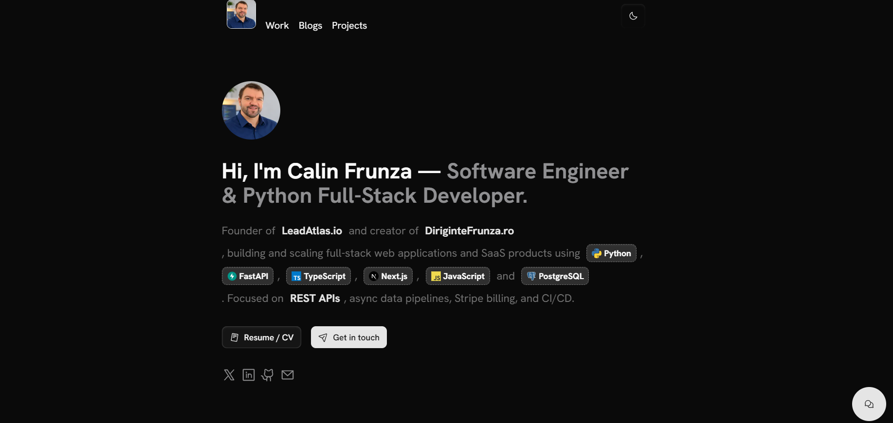

# Călin Frunză — Developer Portfolio

My personal portfolio website built with Next.js 15, TypeScript, Tailwind CSS, and Shadcn UI. Features a project showcase, work experience timeline, blog system, and a contact form with Telegram integration.

🌐 **Live:** [https://calinfrunza.eu](https://calinfrunza.eu/)



## Tech Stack & Features

- **Next.js 15** with App Router
- **TypeScript** for type safety
- **Tailwind CSS** & **Shadcn UI** components
- **Dark / Light** theme support
- **MDX** for blog posts and detailed project case studies
- **Contact Form** with instant Telegram notifications
- **Vercel Analytics** & **Umami Analytics**
- **SEO** optimized with dynamic metadata

## Prerequisites

- Node.js (v18 or higher)
- Bun (recommended) or npm

## Environment Variables

Create a `.env` file in the root directory with the following variables:

```env
TELEGRAM_BOT_TOKEN="your-token"
TELEGRAM_CHAT_ID="your-chat-id"
GEMINI_API_KEY="your-api-key"
NODE_ENV="development"
NEXT_PUBLIC_URL="[https://calinfrunza.eu](https://calinfrunza.eu)"
NEXT_PUBLIC_UMAMI_SRC="your-umami-script-url"
NEXT_PUBLIC_UMAMI_ID="your-umami-website-id"